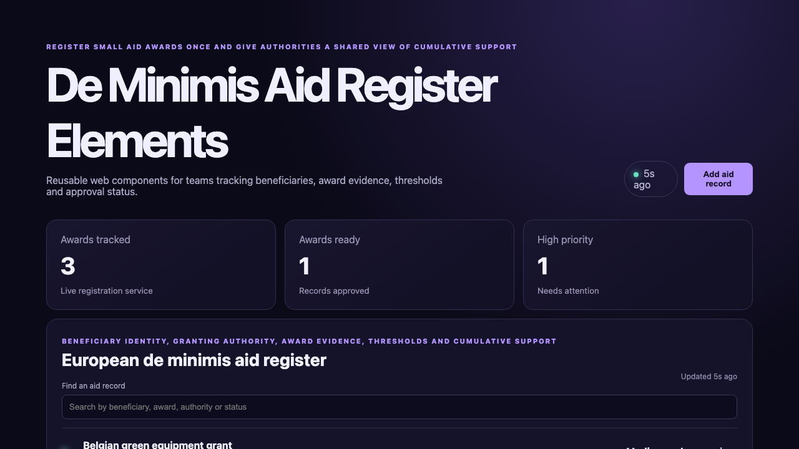

# De Minimis Aid Register Elements

## One-sentence benefit

Give public authorities a clear shared record of small state-aid awards and cumulative beneficiary support.

## Live demo

[Watch the workflow](docs/demo.webm).

## Screenshots

## Main features

- Search aid records by beneficiary, scheme, authority or status.
- Create de minimis award records through the Java API.
- Advance records through evidence review and approval.
- Display loading, empty, error and success feedback.
- Reuse encapsulated metric and workspace components responsively.

## Technology used

Lit, TypeScript, native custom elements, shadow DOM, Vite, Spring Boot and Java 21.

## Installation instructions

Install Node.js 22 and Java 21. Run `npm install`, then start the backend with `cd backend && mvn spring-boot:run`. In another terminal run `npm run dev`.

## Commercial licensing/contact

Commercial licensing and integration support are available. Use the repository contact options to discuss deployment.

## Business problem and users

Granting authorities, state-aid teams, auditors and beneficiaries need consistent award evidence and a shared view of cumulative de minimis support.

## Key workflows

Find an aid award, create a register record, review its responsible authority, advance its verification state and inspect updated metrics.

## Lit/Web Components framework highlights

Lit reactive properties drive API state, repeat directives render keyed records, shadow DOM encapsulates styles and custom elements make the metrics reusable.

## Java backend highlights

Spring Boot provides validated list, search, create and update endpoints, structured errors, health status and domain service tests.

## Architecture and state flow

The custom element fetches `/api/items`; Vite proxies to Spring Boot, where the controller validates data and the service returns updated aid records.

## Accessibility and responsive behaviour

Labelled controls, semantic regions, visible states, keyboard-ready buttons and responsive components support both compact and wide layouts.

## Verification commands

Run `npm test`, `npm run build`, `cd backend && mvn test` and `cd backend && mvn package`.

## Structure

`src` contains the custom elements, `backend` contains the Java API, and `docs` contains inspected product media.

## Tradeoffs

The sample uses in-memory data and simplified workflow states. Production use should add verified factors, persistent datasets and audit trails.

## Roadmap

Add beneficiary identifiers, rolling threshold checks, authority imports, multilingual notices and audit-ready exports.
